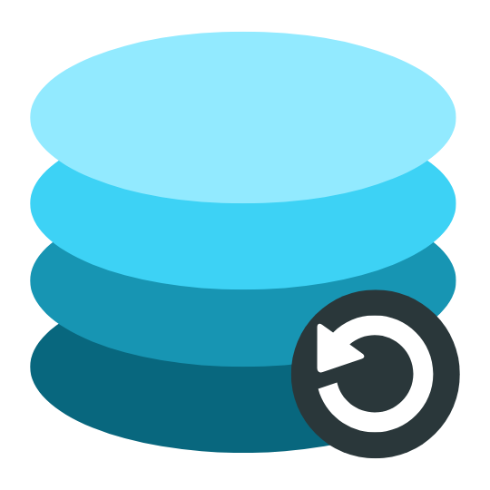

<p align="center">
  

  <h1 align="center">DBEaseBackup</h1>
  <p align="center">Scheduled database backups to Google Drive or S3, verified and pruned by retention.</p>
  <p align="center">
    <a href="https://dbease.glennprays.com/docs/"></a>
    <a href="https://github.com/glennprays/dbeasebackup/actions/workflows/build-docker-image.yml"></a>
    <a href="https://hub.docker.com/r/glennprays/dbeasebackup"></a>
    
  </p>
</p>

DBEaseBackup is a single Go process that backs up each configured database target on its own cron schedule, verifies the backup, uploads it to Google Drive or an S3-compatible bucket, and deletes copies older than the target's retention window. It keeps no state of its own and exposes `/health`, `/readyz` and `/livez` for your orchestrator.

PostgreSQL is supported today, with `pg_dump` (one database) and `pg_basebackup` (whole cluster) modes. Support for more database engines is planned.

**Documentation: https://dbease.glennprays.com/docs/**

## Quick start

Write a targets file with one target per database:

```yaml
# targets.yaml
targets:
  - name: app-db
    mode: dump
    host: db.internal
    port: "5432"
    user: backup
    password_env: APP_DB_PASSWORD
    database: appdb
    schedule: "0 2 * * *"
    retention_days: 30
    backup_dir: /tmp/dbeasebackup/app-db
```

Put global settings and secrets in `.env`:

```bash
TARGETS_FILE=/config/targets.yaml
APP_DB_PASSWORD=change-me

STORAGE_TYPE=s3
S3_ENDPOINT=https://s3.us-east-1.amazonaws.com
S3_BUCKET=my-db-backups
S3_REGION=us-east-1
S3_ACCESS_KEY_ID=AKIA...
S3_SECRET_ACCESS_KEY=...
```

Start the container and check health:

```bash
docker run -d --name dbeasebackup \
  --restart unless-stopped \
  --env-file .env \
  -v "$(pwd)/targets.yaml:/config/targets.yaml:ro" \
  -p 8080:8080 \
  glennprays/dbeasebackup:latest

curl -s localhost:8080/health
```

> [!NOTE]
> `TARGETS_FILE`, `basebackup` mode and retries arrive in the first release after `v2.2.0`. On `v2.2.0` and older, use the [legacy single-database variables](https://dbease.glennprays.com/docs/legacy-single-db/).

The full walkthrough, including Google Drive, is in the [quick start](https://dbease.glennprays.com/docs/quick-start/).

## Documentation

- [Introduction](https://dbease.glennprays.com/docs/introduction/): how a run works and what is out of scope
- [Targets file](https://dbease.glennprays.com/docs/targets-file/) and [environment variables](https://dbease.glennprays.com/docs/environment-variables/)
- [Backup modes](https://dbease.glennprays.com/docs/backup-modes/), [verification](https://dbease.glennprays.com/docs/verification/), [retention](https://dbease.glennprays.com/docs/retention/) and [restoring](https://dbease.glennprays.com/docs/restoring/)
- [Google Drive](https://dbease.glennprays.com/docs/google-drive/) and [S3](https://dbease.glennprays.com/docs/s3/) storage
- [Health checks](https://dbease.glennprays.com/docs/health-checks/), [webhooks](https://dbease.glennprays.com/docs/webhooks/) and [logging](https://dbease.glennprays.com/docs/logging/)
- [Security](https://dbease.glennprays.com/docs/security/) and [troubleshooting](https://dbease.glennprays.com/docs/troubleshooting/)

The docs source lives in [`site/content/docs`](./site/content/docs). Build and preview the site locally with `make site-serve` (http://localhost:4000).

## Build from source

Requires Go 1.26 or newer, plus the PostgreSQL client tools on `PATH` at runtime.

```bash
git clone https://github.com/glennprays/dbeasebackup.git
cd dbeasebackup
make build
./dbeasebackup
```

## Contributing

See [CONTRIBUTING.md](./CONTRIBUTING.md) for development setup, code style and the pull request process.

## License

MIT. See [LICENSE](LICENSE).
